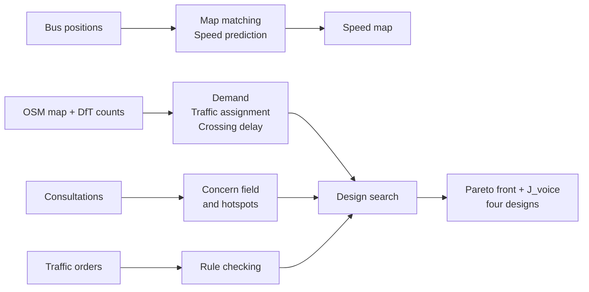

# Edinburgh's Invisible Streets

HackTheBurgh XIII, Team Civilian$: Yakshdevsing (Adish) Boodhun, Darryl Liu Liong Wah, Matthew Li and Matthew Miezaniec.

Edinburgh's Old Town streets have three layers you can't see on a map: the rules (traffic orders buried in PDFs), the complaints (scattered across council consultations) and the actual traffic (most streets have no counter). We collect all three, fill in the missing traffic using live bus positions, and use the lot to pick street designs that follow the real rules, respond to real complaints and still hold up on bad days.

## What it does

- **Traffic.** We poll live bus positions from bustimes.org, match each ping to the street it was on and work out bus-observed speeds. A LightGBM model fills in the streets no bus covered and puts an error bar on each prediction.
- **Rules.** We copy clauses from Edinburgh's traffic orders by hand, check every quote against the source text and compare each rule with OpenStreetMap. If the parser can't read a clause, it flags it for review instead of guessing.
- **Complaints.** We spread consultation comments onto the streets they mention and test where they cluster more than you'd expect by chance.
- **Designs.** We try every legal combination of a few street changes (closures, bus lanes, signalised crossings) under several demand scenarios, model how drivers and pedestrians respond, and keep the designs nothing else beats. Four of them go on the map.
- **Site.** A React + MapLibre map with four views: Traffic, Rules, Complaints and Designs.

### Current numbers

From the data the site ships with (`frontend/public/data/`):

- In the 08:00–08:45 window, 66% of street-time in the study area had no bus reading (80% overnight), so the model predicts it. Its mean error is 6.9 km/h against 7.8 km/h for the best simple baseline, and its ±14.1 km/h interval covered 90% of held-out readings.
- Of the 25 traffic-order rules we could apply, 10 are missing or wrong on OpenStreetMap. Another 46 clauses are flagged for review.
- Every chosen design is consistent with 16 verified clauses and in tension with 9, with 46 left for review.

Speeds are bus-observed, not general traffic speeds, and nothing here has been legally approved.

## Quick start

### Look at the site

The site's data is committed, so it runs straight from a clone. You need Node.js.

```bash
cd frontend
npm install
npm run dev
```

### Set up Python

Python 3.12 is what we tested on (3.10 or newer works).

```bash
python -m venv .venv
source .venv/bin/activate          # Windows: .venv\Scripts\activate
pip install -r data/requirements.txt scipy networkx
```

On macOS, LightGBM also needs OpenMP: `brew install libomp`. Don't `pip install orchid`, it's an unrelated package. The ORCHID code we use is already in `vendor/orchid/`.

### Get the raw data

None of this is in git.

| File | Where it comes from |
| --- | --- |
| `data/raw/osm.json` | The team's OpenStreetMap download. Get it from Adish rather than downloading it again, or the edge ids won't match. |
| `data/raw/dft_aadf.csv` | [DfT traffic counts](https://roadtraffic.dft.gov.uk/local-authorities/29) for the City of Edinburgh |
| `data/raw/concerns.csv` | Built by hand from published consultation material: theme, lat, lon, street, count, severity |
| `data/rules/clauses.json` and `data/raw/sources/<document_id>.txt` | Traffic-order clauses copied by hand, and the text of each order |
| `data/raw/pings.csv` | Written by the bus collector (see below) |

### Run the Engine pipeline

From the repo root, in this order:

```bash
python -m src.graph.build_graph              # OSM -> street graph
python -m src.graph.count_points             # DfT counts -> streets
python -m src.rules.bind_rules               # traffic orders -> rules, OSM mismatches
python -m src.rules.compile_rules            # the same rules through ORCHID's policy compiler
python -m src.concerns.concern_field         # complaints -> concern score per street
python -m src.concerns.hotspots              # complaint hotspots
python -m src.decide.od_matrix_estimation    # morning-peak trips, fitted to the counts
python -m src.decide.baseline_user_equilibrium
python -m src.decide.pedestrian_crossing_delay
python -m src.decide.scenarios
python -m src.decide.propose_candidates
python -m src.decide.interventions           # drops options the rules forbid
python -m src.decide.design_search           # every design under every scenario
python -m src.decide.best_trade_offs         # Pareto front, J_voice and the picks
python -m src.rules.policy_check
python -m src.decide.tail_risk_comparison
python -m src.decide.emissions               # display only
```

The design search saves its progress as it goes, so you can stop and restart it. To split it across machines, use `--shard K/N`, then join the parts with `--merge N`.

### Run the Signal pipeline (bus speeds)

```bash
cd data && python collector.py collect --interval 30    # leave it running; writes raw/pings.csv
cd ..
python scripts/run_matching.py --start 2026-11-08T08:00 --end 2026-11-08T09:00 --out data/derived/speeds_0800.csv
PYTHONPATH=.:data python scripts/run_signal.py --speeds data/derived/speeds_0800.csv
```

`run_signal.py` joins the speed windows, scores the model against both baselines, predicts the streets with no bus data and writes a summary to `data/derived/`. On Windows, use `;` instead of `:` in `PYTHONPATH`.

### Update the site's data

```bash
python -m src.api.export     # writes frontend/public/data/
```

Only the street graph is required. Any layer whose inputs are missing is left out.

### Run the tests

```bash
pytest                       # everything under tests/
cd frontend && npm test
```

The speed model tests need LightGBM installed.

## How it works: the maths

A short version of each step is below. The full version, with every formula and what each symbol means, is in [docs/MATHEMATICS.md](docs/MATHEMATICS.md).



**Map matching.** A Hidden Markov Model solved with the Viterbi algorithm (Newson–Krumm). Each ping scores nearby streets by how close it is (Gaussian error, σ = 4.07 m) and by whether the jump from the previous street makes sense. Speed on a street is total metres driven divided by total seconds.

**Speed prediction.** Gradient-boosted trees (LightGBM), tested on whole streets and later hours the model never saw, and compared with two simple baselines. Each prediction gets a split conformal interval $`\hat{y} \pm q`$, where $`q`$ is the 90% quantile of the model's out-of-fold errors.

**Travel demand.** A gravity model gives a first guess at morning-peak trips between 20 zones, then generalised least squares adjusts it to match the DfT counts:

```math
T^{0}_{ij} = k \, O_i \, D_j \, e^{-\beta c_{ij}}, \qquad \beta = \frac{1}{\bar{c}}
```

**Traffic assignment.** User equilibrium, where no driver can save time by changing route, solved with Algorithm B. Streets slow down as they fill up, following the BPR curve:

```math
t_e(f_e) = t^{0}_e \left[ 1 + 0.15 \left( \frac{f_e}{c_e} \right)^{4} \right]
```

We check the solver against the Braess paradox (83 → 92 per driver) before trusting it.

**Crossing delay.** Signalised crossings wait $`(C - g)^2 / 2C`$, zebras a fixed 3 s, and unmarked crossings use Adams' gap-acceptance delay, capped at 60 s:

```math
d = \frac{e^{q t_c} - q t_c - 1}{q}
```

**Complaints.** Each complaint is spread onto nearby streets with a Gaussian kernel (σ = 50 m). Hotspots come from a binomial test of comments against street length, with a Benjamini–Hochberg correction at a 5% false-discovery rate.

**Design search.** Every legal design, $`2^k`$ of them with $`k \le 8`$, is tested under a reduced set of demand scenarios. Alongside the average we look at the worst 10% of scenarios (CVaR):

```math
\text{CVaR}_{0.9} = \text{VaR}_{0.9} + \frac{1}{0.1} \sum_{s} p_s \max\left(0, \; J_s - \text{VaR}_{0.9}\right)
```

**Picking designs.** We keep the exact Pareto front over driving time, crossing delay and bad-day risk, plus J_voice when complaints have real locations, then measure it with the hypervolume and find the knee. J_voice weights how much each design changes conditions on each street by how much people complained about it:

```math
J_{\text{voice}}(x) = \sum_{j} \sum_{e} s_e^{j} \, m_e^{j}(x)
```

**Rule checking.** Every quote is checked letter by letter against the traffic order. Rules are parsed with a closed grammar, so a clause it can't fully read is flagged for review instead of guessed.

Most of these steps use the vendored ORCHID library below. The speed model, hotspots and J_voice are built on LightGBM, numpy, scipy and networkx.

## ORCHID library (vendored)

The maths comes from ORCHID: 14 modules copied byte for byte into `vendor/orchid/` from ORCHID
commit `81022c7`, which is pinned in `scripts/sync_orchid.py`. They use only the standard
library and need Python 3.8+, so there is nothing to install and no ORCHID clone to set up.
Import them through one wrapper, and run code from the repo root (e.g.
`python -m src.graph.build_graph`):

```python
from engine.orchid import street_network as sn, traffic_assignment as ta
```

| Module | Plan step | Key functions |
| --- | --- | --- |
| `street_network` | §2 graph, map matching, map layers; §3 features | `RoadGraph`, `HIGHWAY_DEFAULTS`, `clean_network`, `EdgeIndex`, `map_match`, `snap_point`, `to_geojson`, `edge_betweenness_centrality` |
| `traffic_assignment` | §2 vehicle response | `user_equilibrium`, `detect_braess` |
| `travel_demand` | §2 demand | `gravity_model`, `gls_matrix_estimation` |
| `pedestrian_flow` | §2 pedestrians | `crossing_delay`, `fruin_los` |
| `public_voice` | §2 complaints; §4 J_voice (**not converged**, see below) | `ingest_concerns`, `classify_theme`, `find_near_duplicates`, `concern_field`, `local_getis_ord`, `hotspot_clusters`, `voice_objective`, `voice_improvement` |
| `emissions_environment` | display only | `network_emission_proxy` |
| `data_splitting` | §3 validation | `GroupKFold`, `TimeSeriesSplit` |
| `ensembles` | §3 model fallback | `GradientBoostingRegressor` (no quantile loss) |
| `multi_objective` | §4 Pareto + pick | `find_pareto_front`, `hypervolume`, `knee_point` |
| `stochastic_optimisation` | §4 scenarios + risk | `scenario_reduction`, `conditional_value_at_risk` |
| `policy_compiler` | §2 rules, OSM mismatch, policy check | `PolicyClause`, `Gazetteer`, `compile_policy`, `verify_span`, `policy_check`, `pareto_set` |
| `traffic_flow`, `accessibility_equity`, `signal_control` | not used by the plan | |

Each module's API docs are in its `README.md` under `vendor/orchid/algorithms/`. The test
counts in those READMEs are out of date.

**Held back.** These raise `ImportError`, with the reason, if you import them from
`engine.orchid`:

- `network_design`, `resilience`: ORCHID's bug hunts on them haven't converged.
- `green_infrastructure`: a min-cut-tree bug against the current core.
- core `probabilistic`: a known erf defect.

**Vendored before convergence.** `public_voice` and `policy_compiler` are enabled although
their hunts haven't converged:

- `public_voice`: rounds 6 and 7 found and fixed 5 and 4 template bugs, so a later round may
  find more. Sanity-check every number from it before showing it. Our concern hotspots (#35,
  `src/concerns/hotspots.py`) and J_voice (#36, `src/decide/voice_objective.py`) don't use it;
  they are built on numpy, scipy and networkx.
- `policy_compiler`: see the caveat below.

To enable one once it's fixed:

1. Move its line from `HELD` to `URBAN_READY` in `scripts/sync_orchid.py`.
2. Add its import to `engine/orchid.py`.
3. Run `python scripts/sync_orchid.py --orchid ../orchid`.
4. Check a known answer (e.g. Braess 83/498 -> 92/552) before showing any number from it.

**`policy_compiler` caveat.** It is enabled with hunt rounds 6-8 merged (ORCHID #4, #6, #7), but its
hunts haven't converged. Almost every bug found was in `classify_wording`, which reads
English wording for the `wording_ambiguous` check. Set each clause's `strength` ("hard" or
"soft") by hand rather than trusting the wording reader, and check the abstention queue by eye.

**Rules.** Never edit `vendor/`. Never put an ORCHID checkout on `sys.path` / `PYTHONPATH`.
Import only through `engine.orchid`. `python scripts/sync_orchid.py --check` verifies the
copy.

**Gotchas.**

- Plan §2's `pareto_set` lives in `policy_compiler`. `multi_objective.find_pareto_front` +
  `knee_point` work too.
- There is no `RoadGraph` -> `traffic_assignment` network adapter, so we write that glue
  ourselves.
- `street_network`'s node-graph routers ignore banned turns. Use `edge_expanded_graph` /
  `turn_aware_shortest_path` for turn bans from traffic orders.
