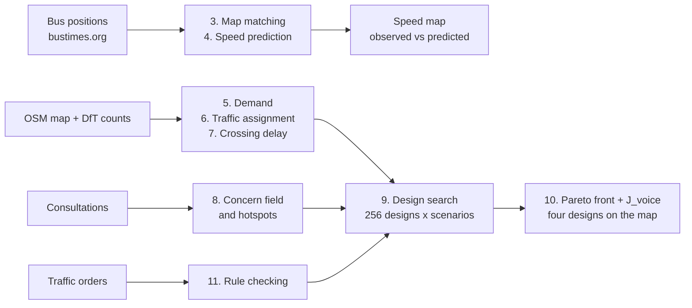

# The maths behind Edinburgh's Invisible Streets

This is the maths we actually run. For each step there's a short summary, the formulas, and what each symbol means. All the numbers come from scripts in this repo.

## 1. Data sources

We only use public data. For each layer we picked the best open source we could find.

- **Bus positions:** [bustimes.org](https://bustimes.org/)
  - Why: the only live feed with Lothian buses
- **Street map:** OpenStreetMap
  - Why: free and detailed
- **Legal rules:** [Edinburgh traffic orders](https://www.edinburgh.gov.uk/trafficorders)
  - Why: it's the actual law
- **Complaints:** [council consultations](https://consultationhub.edinburgh.gov.uk/)
  - Why: what residents actually said
- **Traffic counts:** [DfT AADF](https://roadtraffic.dft.gov.uk/local-authorities/29)
  - Why: the only official counts
- **Backup:** [DataShare bus GPS, 2014–15](https://datashare.ed.ac.uk/handle/10283/2089)
  - Why: in case the live feed goes down

## 2. Overview

How the data gets from the sources to the final designs. The numbers match the sections below.



The concern scores from section 8 also go into the speed model as a feature, and into J_voice in section 10.

## 3. Map matching

GPS pings are a few metres off, so first we work out which street each bus was really on. Then we turn the pings into speeds.

- **What:** Hidden Markov Model + Viterbi
- **Does:** pings → streets
- **Speed:** metres ÷ seconds
- **Why:** much better than snapping to the nearest street
- **Effect:** gives us the street speed table
- **Alternatives:** nearest-street snapping, OSRM, Valhalla

### Formulas

```math
p(z_t \mid r) = \frac{1}{\sqrt{2\pi}\,\sigma_z} \exp\left(-\frac{1}{2}\left(\frac{\lVert z_t - x_{t,r} \rVert}{\sigma_z}\right)^{2}\right)
```

```math
p(r_{t-1} \to r_t) = \frac{1}{\beta} \exp\left(-\frac{\left| d_{\text{straight}} - d_{\text{route}} \right|}{\beta}\right)
```

```math
r^{*} = \arg\max_{r_1 \dots r_T} \prod_{t} p(z_t \mid r_t)\, p(r_{t-1} \to r_t)
```

```math
v_e = \frac{\sum \text{metres driven on } e}{\sum \text{seconds spent on } e}
```

### Where

- $`z_t`$: GPS ping at time t
- $`r`$: a candidate street
- $`x_{t,r}`$: the closest point on r
- $`\sigma_z`$: GPS error, 4.07 m
- $`\beta`$: how far the route can stray from a straight line, 5 m
- $`d_{\text{straight}}, d_{\text{route}}`$: straight-line distance vs driving distance
- $`r^{*}`$: the most likely path through the streets
- $`v_e`$: speed on street e

## 4. Speed prediction

Most streets never get a bus, so we predict their speeds and give each prediction an error bar.

- **What:** LightGBM (gradient-boosted trees)
- **Does:** fills in streets with no bus data
- **Tested on:** streets it hasn't seen, and later hours
- **Error bar:** conformal, ±14.2 km/h
- **Why:** beats both simple baselines
- **Effect:** the predicted layer on the speed map
- **Alternatives:** random forest, kriging

### Formulas

```math
\hat{y}(x) = \sum_{m=1}^{M} \eta \, f_m(x)
```

```math
\text{MAE} = \frac{1}{n} \sum_{i=1}^{n} \left| y_i - \hat{y}_i \right|
```

```math
\text{interval} = \hat{y}(x) \pm q, \qquad q = \text{the } (1-\alpha) \text{ quantile of } \left| y_i - \hat{y}_{-k(i)}(x_i) \right|
```

### Where

- $`\hat{y}`$: predicted speed
- $`f_m`$: the m-th small tree
- $`\eta`$: learning rate
- $`y_i`$: observed speed
- MAE: mean absolute error
- $`\hat{y}_{-k(i)}`$: a prediction from a model that never saw row i
- $`\alpha`$: 0.1, so we aim for 90% coverage
- $`q`$: 14.2 km/h
- Baseline 1: average speed for the road class and hour
- Baseline 2: speed of the nearest street with bus data

## 5. Travel demand

There's no survey of real trips, so we estimate how many cars travel between zones in the morning peak and then fit that to the DfT counts.

- **What:** gravity model + GLS
- **Does:** trips from zone to zone
- **Fitted to:** DfT counts
- **Why:** we don't have trip data
- **Effect:** everything traffic-related depends on it
- **Alternatives:** entropy maximisation, mobile phone data

### Formulas

```math
T^{0}_{ij} = k \, O_i \, D_j \, e^{-\beta c_{ij}}, \qquad \beta = \frac{1}{\bar{c}}
```

```math
q_{\text{peak}} = 0.09 \times \text{AADF}
```

```math
\hat{T} = \arg\min_{T \ge 0} \; w_0 \left\lVert T - T^{0} \right\rVert^{2}_{V_0^{-1}} + w_1 \left\lVert P\,T - q_{\text{peak}} \right\rVert^{2}_{V_1^{-1}}
```

### Where

- $`T_{ij}`$: trips from zone i to zone j
- $`T^{0}`$: the gravity model's first guess
- $`O_i, D_j`$: trips starting and ending in each zone
- $`c_{ij}`$: free-flow travel time between zones
- $`\bar{c}`$: average travel time between zones
- $`k`$: scales the total number of trips
- AADF: average daily traffic count
- $`P`$: how much of each trip goes along each counted street
- $`w_0, w_1`$: weights, both 1
- $`V_0, V_1`$: variances
- Zones: 20, grouped with k-means

## 6. Traffic assignment

Given those trips, this works out which route each driver takes, including after a design closes or narrows a street.

- **What:** user equilibrium
- **Solver:** Algorithm B
- **Congestion:** BPR curve
- **Sanity check:** Braess paradox
- **Why:** it predicts where traffic goes when a street changes
- **Effect:** J_car and the flow on every street
- **Alternatives:** Frank–Wolfe, SUMO

### Formulas

```math
t_e(f_e) = t^{0}_e \left[ 1 + \alpha \left( \frac{f_e}{c_e} \right)^{\beta} \right], \qquad \alpha = 0.15,\; \beta = 4
```

```math
\min_{f} \; \sum_{e} \int_{0}^{f_e} t_e(w)\, dw
```

```math
J_{\text{car}} = \sum_{e} f_e \, t_e(f_e)
```

```math
\text{gap} = \frac{\sum_e f_e t_e - \sum_{od} T_{od} \, \pi_{od}}{\sum_e f_e t_e} \le 10^{-6}
```

### Where

- User equilibrium: no driver can save time by switching route
- $`t_e`$: travel time on street e
- $`t^{0}_e`$: travel time with no traffic
- $`f_e`$: flow, vehicles per hour
- $`c_e`$: capacity, vehicles per hour
- $`\alpha, \beta`$: shape of the BPR curve
- The second formula is the Beckmann objective. Its minimum is the equilibrium.
- $`J_{\text{car}}`$: total time spent driving
- $`T_{od}`$: trips from origin to destination
- $`\pi_{od}`$: time on the fastest route
- gap: how far we are from equilibrium
- Braess check: 83 → 92 per driver (498 → 552 in total)

## 7. Crossing delay (J_ped)

How long a pedestrian waits to cross. It depends on how much traffic there is.

- **Signals:** wait for the green man
- **Zebra:** a fixed 3 s
- **No markings:** Adams' gap-acceptance delay
- **Cap:** 60 s
- **Why:** it ties pedestrians to the car model
- **Effect:** the J_ped objective
- **Alternatives:** HCM tables, crowd models

### Formulas

```math
d_{\text{unmarked}} = \min\left( \frac{e^{q t_c} - q t_c - 1}{q}, \; 60\,\text{s} \right)
```

```math
d_{\text{signal}} = \frac{(C - g)^{2}}{2C}
```

```math
J_{\text{ped}} = \sum_{k} d_k
```

### Where

- $`d`$: average wait to cross
- $`q`$: car flow, vehicles per second
- $`t_c`$: critical gap, the time it takes to cross
- $`C`$: signal cycle, 90 s
- $`g`$: green man time, 8 s
- Zebra: a fixed 3 s
- $`d_k`$: delay at crossing k
- $`J_{\text{ped}}`$: total delay over all crossings

## 8. Complaints

We spread each complaint onto the streets around it, then test which areas get more complaints than you'd expect by chance.

- **Field:** Gaussian kernel, 50 m
- **Hotspots:** binomial test
- **Correction:** Benjamini–Hochberg
- **Why:** so random noise doesn't show up as hotspots
- **Effect:** the hotspot map and J_voice
- **Alternatives:** Getis–Ord, SaTScan

### Formulas

```math
s_e^{j} = \sum_{i} \text{sev}_i \, \text{count}_i \, \exp\left(-\frac{d(e, \text{loc}_i)^{2}}{2\sigma^{2}}\right) \mathbb{1}\left[\text{theme}_i = j\right]
```

```math
p_e = P\left(X \ge o_e\right), \qquad X \sim \text{Binomial}\left(N, \; \frac{L_{J(e)}}{L_{\text{total}}}\right)
```

```math
q_{(k)} = \min_{j \ge k} \frac{m \, p_{(j)}}{j}, \qquad \text{hot if } q_e \le 0.05 \text{ and } o_e > N \frac{L_{J(e)}}{L_{\text{total}}}
```

### Where

- $`s_e^{j}`$: concern score for street e and theme j
- $`\text{sev}_i`$: how severe complaint i is
- $`\text{count}_i`$: number of comments in record i
- $`d`$: distance to the complaint
- $`\sigma`$: 50 m, cut off at 150 m
- $`o_e`$: comments within 130 m
- $`N`$: all comments with a location
- $`L_{J(e)}`$: length of street within 130 m
- $`L_{\text{total}}`$: length of the whole network
- $`m`$: number of street segments tested
- $`p_{(j)}`$: the p-values, smallest first
- $`q`$: p-value after the Benjamini–Hochberg correction

## 9. Design search

We score every legal design under every scenario, and look at how each one does on the worst days as well as on average.

- **What:** try all 256 designs
- **Scenarios:** cut down with fast-forward reduction
- **Risk:** CVaR, the worst 10%
- **Rules:** illegal designs are removed first
- **Why:** it gives the exact best answer, not an estimate
- **Effect:** the "bad day" comparison
- **Alternatives:** genetic algorithm, MILP

### Formulas

```math
\text{designs} = 2^{k}, \qquad k \le 8
```

```math
\text{VaR}_{\alpha} = \min \left\{ \ell : P(J \le \ell) \ge \alpha \right\}
```

```math
\text{CVaR}_{\alpha} = \text{VaR}_{\alpha} + \frac{1}{1-\alpha} \sum_{s} p_s \max\left(0, \; J_s - \text{VaR}_{\alpha}\right), \qquad \alpha = 0.9
```

```math
J_{\text{robust}}(x) = \mathbb{E}\left[J(x, D)\right] + \lambda \, \text{CVaR}_{0.9}\left(J(x, D)\right)
```

```math
D_K = \sum_{s \notin K} p_s \min_{k \in K} \left\lVert \xi_s - \xi_k \right\rVert
```

### Where

- $`k`$: number of yes/no options
- $`J_s`$: total driving time in scenario s
- $`p_s`$: probability of scenario s
- VaR: where the worst 10% starts
- CVaR: the average of the worst 10%
- $`\lambda`$: how much weight we give to risk
- $`D`$: a demand scenario
- $`K`$: the scenarios we keep
- $`\xi`$: a scenario as numbers (demand, closure)
- $`D_K`$: Kantorovich distance, which we keep as small as possible
- Demand levels: ×0.75, ×1.0, ×1.25, ×1.5

## 10. Picking designs

Most designs are beaten on everything by another design. We keep the ones that aren't, and pick four of them to show.

- **Pareto front:** designs nothing else beats
- **Hypervolume:** how good the front is overall
- **Knee:** the best compromise
- **J_voice:** burden weighted by complaints
- **Picks:** best for cars, best for pedestrians, best for complaints, the knee
- **Why:** it shows the trade-offs instead of hiding them in one score
- **Alternatives:** weighted sum, NSGA-II

### Formulas

```math
x \prec y \iff f_i(x) \le f_i(y) \;\; \forall i \;\text{ and }\; f_i(x) < f_i(y) \text{ for some } i
```

```math
\tilde{f}_i = \frac{f_i - \min f_i}{\max f_i - \min f_i}
```

```math
\text{HV} = \text{Vol}\left( \bigcup_{x \in \text{front}} \left[ \tilde{f}(x), \, r \right] \right), \qquad r = (1.1, \dots, 1.1)
```

```math
\text{knee} = \arg\max_{p} \frac{\left| (b - a) \times (p - a) \right|}{\left\lVert b - a \right\rVert}
```

```math
J_{\text{voice}}(x) = \sum_{j} \sum_{e} s_e^{j} \, m_e^{j}(x), \qquad m = \begin{cases} x / b & b \ge 0.01\, \bar{b}_{+} \\ 1 + (x - b) / \bar{b}_{+} & \text{otherwise} \end{cases}
```

```math
\text{improvement} = 1 - \frac{J_{\text{voice}}(x)}{J_{\text{voice}}(\text{today})}
```

### Where

- $`x \prec y`$: x is at least as good as y on everything, and better on something
- $`f_i`$: objective i (J_car, J_ped, J_risk, J_voice)
- $`\tilde{f}`$: the objective rescaled to 0–1
- HV: hypervolume
- $`r`$: reference point, 1.1 on each axis
- $`a, b`$: the two ends of the front (J_car vs J_risk)
- $`p`$: a design on that front
- $`s`$: concern score from section 8
- $`m`$: burden compared with today
- $`x, b`$: the design's value and today's value
- $`\bar{b}_{+}`$: average of today's values that are above zero
- What m measures: car flow, vehicle-hours, or crossing delay, depending on the theme

## 11. Rule checking

We turn the traffic orders into rules the search has to follow. If the parser isn't sure about a clause, it says so instead of guessing.

- **Quotes:** checked letter by letter against the order
- **Parser:** closed grammar
- **When unsure:** flags the clause for review
- **Output:** count of rules OSM gets wrong
- **Why:** we can't afford to misread the law
- **Effect:** illegal designs never get built
- **Alternatives:** reading the PDFs with an LLM, regex

### Formulas

```math
z_e \in \{0, 1\}, \qquad z_e = 0 \text{ if prohibited}, \qquad z_e = 1 \text{ if protected}
```

```math
\text{mismatch rate} = \frac{N_{\text{rules wrong or missing on OSM}}}{M_{\text{rules checked}}}
```

### Where

- $`z_e`$: whether street e is open to traffic (1) or not (0)
- Prohibited: the order bans traffic here, so it stays shut
- Protected: the order says it can't be closed, so it stays open
- Satisfied / in tension / abstained: the result for each clause
- N of M: how many of the rules OSM gets wrong
